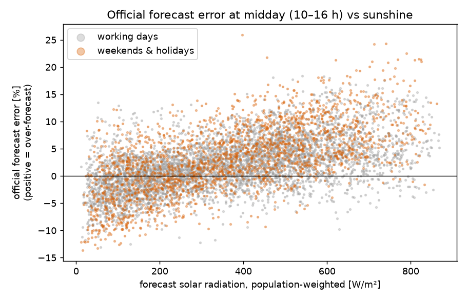
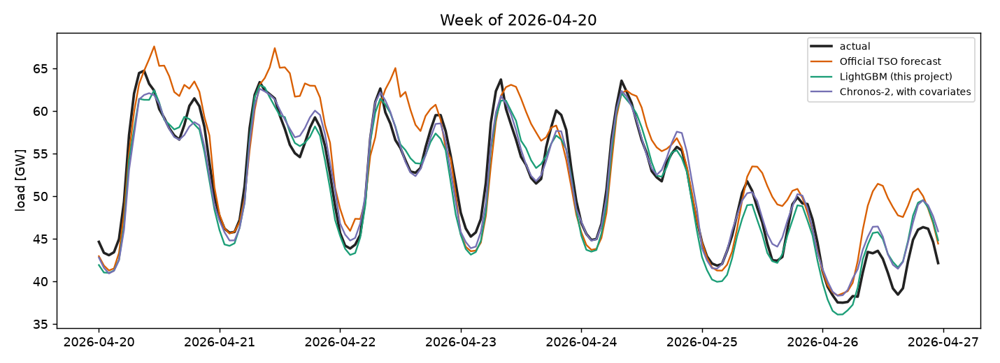
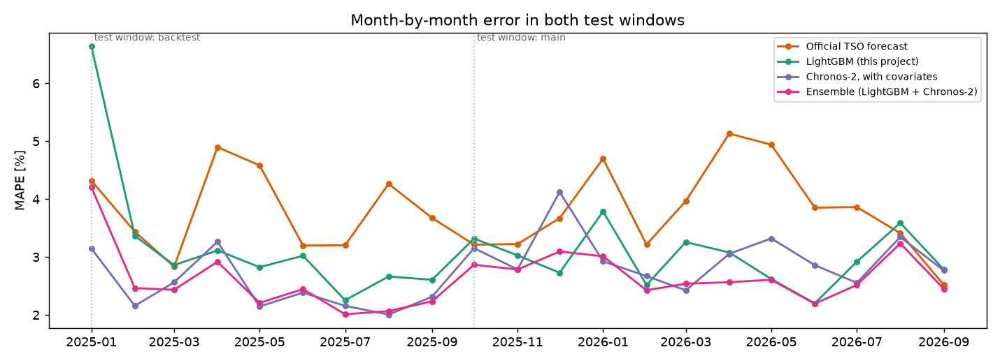
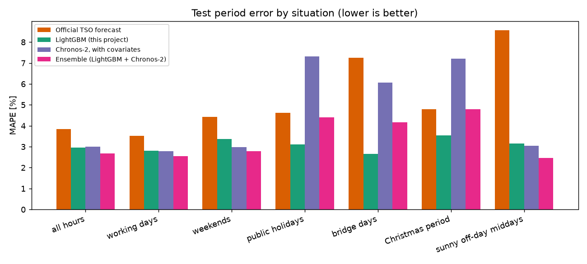

# Beating Germany's official day-ahead load forecast, with less information

Day-ahead forecasts of electricity demand for Germany, benchmarked against the official forecast that the four transmission system operators (TSOs) publish every day. The models use **less information** than the official forecaster, and every modelling choice is fixed on validation data before the test periods are touched.

- An ensemble of gradient boosting and a zero-shot foundation model is **about 30 % more accurate than the official forecast as published and beats it in all 21 test months**, across two separate out-of-sample periods.
- Against a **stronger benchmark**, the official forecast after a simple bias correction that anyone could apply, the margin is **22 % in the main period but only 8 % and not significant in the backtest**.
- Issuing the forecast at 10:00 on the day before and using **that morning's published load**, still well before the official forecast appears, raises the margin over the stronger benchmark to **23 % and 15 %, significant in both periods**.
- Forecast errors are translated into **imbalance costs in euros** using the German imbalance price reBAP.

| MAPE | Main test: Oct 2025 – Sep 2026 | Backtest: Jan – Sep 2025 |
|---|---|---|
| Naive: same hour last week | 5.49 % | 4.86 % |
| **Official TSO forecast, as published** | **3.84 %** | **3.83 %** |
| *Stronger benchmark: official forecast + bias correction* | *3.43 %* | *2.87 %* |
| LightGBM | 2.99 % | 3.26 % *(not significant)* |
| Chronos-2, zero-shot foundation model | 3.01 % | 2.46 % |
| **Ensemble: LightGBM + Chronos-2** | **2.70 %** | **2.55 %** |
| Ensemble, issued 10:00 on D-1 with that morning's load | 2.64 % | 2.43 % |

Full tables: [`reports/RESULTS.md`](reports/RESULTS.md) (main pipeline) and [`reports/EXPERIMENTS.md`](reports/EXPERIMENTS.md) (upper bound, bias correction, morning load) and [`reports/FINETUNE.md`](reports/FINETUNE.md) (fine-tuning).

---

## The finding that started it



At midday the official forecast's error rises almost linearly with solar radiation: it under-forecasts on dull days and over-forecasts by up to 20 % on sunny ones. The likely cause is **behind-the-meter rooftop PV**. When the sun shines, households and businesses consume their own solar power, and the load seen by the grid drops. The effect is strongest on weekends and public holidays, when baseline demand is low. On sunny weekend and holiday middays the official forecast's error is 8.6 % in the main test period and 9.5 % in the backtest; the ensemble's is 2.8 % and 3.3 %.

The largest official errors of the year were on **Sunday 26 April 2026** and **Labour Day, 1 May 2026**, both clear-sky days across all of Germany, with the forecast about 9 GW (24 %) too high.



---

## Fairness: the comparison is only meaningful if the model cannot see the future

The official forecast for day D is published on day D-1 (by 18:00, per [SMARD](https://www.smard.de/page/en/wiki-article/5884/206318/forecast-data)). The main pipeline deliberately uses **less** than that:

| Information | Used for day D | Why it is fair |
|---|---|---|
| Actual load | only up to the end of day **D-2** | same hour 2, 7 and 14 days back |
| Weather | forecasts issued **48 h** before each hour | not observed weather, which would leak the future |
| Calendar, holidays | any | known years in advance |
| Hyperparameters | chosen on a validation period **before** each test period | test data is never used for tuning |
| Model training | retrained monthly on data known at that time | the model never sees the month it predicts |

The rule is enforced by automated tests ([`tests/`](tests)): they scramble the load of days D-1 and D and assert that nothing the model sees for day D changes, and confirm that scrambling day D-2 *does* change it.

Two traps found along the way:

- **Weather archives.** Open-Meteo's *Historical Forecast API* sounds right but stitches together the first few hours of each weather model run, i.e. forecasts with a lead time of only hours. This project uses the *Previous Runs API* with `_previous_day2`, the genuine 48 h-ahead forecast.
- **Daylight saving time.** An early version computed lags as "48 hours earlier". On the day after clocks go back, day D-1 has 25 hours, so 48 hours before the last hour of D is midnight of D-1, which is not yet known. The leak was one hour per year; the original tests missed it because their data did not cover October. Lags are now looked up by local date and hour, and the tests cover both clock changes. Fixing it changed the ensemble's MAPE by at most 0.04 and LightGBM's by at most 0.08 percentage points.

---

## Data

| Data | Source | Resolution |
|---|---|---|
| Actual grid load, official day-ahead load forecast, day-ahead price (DE-LU) | [SMARD](https://www.smard.de) (Bundesnetzagentur) | hourly |
| Temperature, solar radiation, cloud cover: 48 h-ahead forecasts for one city per federal state | [Open-Meteo Previous Runs API](https://open-meteo.com/en/docs/previous-runs-api) | hourly |
| Imbalance price reBAP, quality-assured | [netztransparenz.de](https://www.netztransparenz.de/de-de/Regelenergie/Ausgleichsenergiepreis/reBAP) | 15 min, averaged to hourly |
| Public holidays per federal state | [`holidays`](https://pypi.org/project/holidays/) package | daily |

All sources are free and need no registration. History starts in January 2024, when the weather forecast archive begins.

---

## Method

**Features** ([`features.py`](src/loadfc/features.py)). Hour, weekday, season; the *share of the population* on a public holiday (holidays differ by state, e.g. Epiphany only in BW, BY, ST); bridge days; the Christmas period; load at the same hour 2, 7 and 14 days earlier; population-weighted temperature, radiation and cloud cover, plus radiation in the PV-heavy south.

**LightGBM** ([`models.py`](src/loadfc/models.py)). Gradient-boosted trees with an L1 objective, retrained at the start of every test month on all data known at that time. The number of trees is chosen by early stopping on the validation period.

**Chronos-2** ([`foundation.py`](src/loadfc/foundation.py)). Amazon's 120M-parameter time series foundation model (2025, Apache-2.0), used **zero-shot**: it has never been trained on German load. It receives the load history and the same known-future covariates as LightGBM. The context length (12 weeks or the maximum of about 11 months) is chosen on the validation period; both periods chose the longer one.

**Ensemble.** The plain average of LightGBM and Chronos-2. Equal weights involve no tuning, so evaluating it on the test periods stays fair.

**Two test periods.** Each has its own validation period, and every choice is frozen before its test period is touched:

| | Validation | Test | Training data at test start |
|---|---|---|---|
| Main | Jul – Sep 2025 | Oct 2025 – Sep 2026 | 20 months |
| Backtest | Oct – Dec 2024 | Jan – Sep 2025 | 11 months |

---

## Results



**The ensemble is the only model that beats the published official forecast in every month.** Each component fails somewhere:

- **LightGBM needs history.** At the start of the backtest it had less than a year of training data and little winter. Early stopping on the validation period kept only 155 trees, and its January 2025 error was 6.6 %. Over the backtest its advantage over the official forecast is not statistically significant (p = 0.18). With 20 months of history in the main period it is strong.
- **Chronos-2 needs no training data but struggles with holidays.** Zero-shot, it is the best single model in the backtest. On public holidays, bridge days and at Christmas it is much worse than LightGBM, because holidays are rare in its context window. Even 8,192 hours (341 days) do not reach back to last year's Christmas.
- **Averaging them is the safe choice, not always the best one.** The ensemble beats both components in 12 of 21 months, and in the backtest Chronos-2 alone is slightly better overall. What the ensemble adds is robustness: the two models rarely fail in the same month.



| MAPE [%], main test period | Official | LightGBM | Chronos-2 | Ensemble |
|---|---|---|---|---|
| All hours | 3.84 | 2.99 | 3.01 | **2.70** |
| Working days | 3.51 | 2.82 | 2.83 | **2.58** |
| Weekends | 4.43 | 3.40 | 3.01 | **2.82** |
| Public holidays | 4.61 | **3.18** | 6.03 | 3.90 |
| Bridge days | 7.25 | **2.72** | 6.55 | 4.36 |
| Christmas period | 4.79 | **3.43** | 7.16 | 4.71 |
| Sunny off-day middays | 8.57 | 3.23 | 3.41 | **2.75** |

Public holidays remain the weak spot: in the backtest the ensemble's holiday error (6.0 %) is worse than the official forecast's (5.0 %).

### What drives LightGBM's improvement? (ablation, main period)

| MAPE [%] | All hours | Sunny off-day middays | Public holidays |
|---|---|---|---|
| Full model | 2.99 | 3.23 | 3.18 |
| without solar radiation & cloud | 3.18 | 3.93 | 3.63 |
| without any weather | 3.46 | 4.18 | 4.17 |
| without holiday detail | 3.01 | 3.57 | 4.20 |
| *Official forecast* | *3.84* | *8.57* | *4.61* |

Removing solar features hurts exactly where the PV hypothesis predicts. But even with **no weather at all**, LightGBM still beats the official forecast, so calendar handling and recent load level matter as much as sunshine.

---

## A stronger benchmark: the official forecast after bias correction

The official forecast's errors are not random: they drift in one direction for weeks, e.g. +2 GW on average in April and May. Such persistent bias can be removed with a few lines of code, so beating the *raw* official forecast partly means beating a fixable bias.

The correction subtracts a share `alpha` of the forecast's mean error over the last `window_days` days, per hour of the day, using only errors known at forecast time (up to day D-2). The parameters are chosen on the validation periods, separately for every forecast, and then frozen ([`experiments.py`](src/loadfc/experiments.py), with its own leakage test).

| MAPE | Main | Backtest |
|---|---|---|
| Official forecast | 3.84 % | 3.83 % |
| Official forecast + bias correction | 3.43 % | 2.87 % |
| Ensemble | 2.70 % | 2.55 % |
| Ensemble + bias correction | 2.66 % | 2.63 % |

- **The correction helps the official forecast a lot and our models hardly at all.** Our models already adapt to the load level through their lagged features; the official forecast does not.
- **Against the corrected official forecast, the main-period result holds** (corrected vs corrected: 22 % lower error, 12 of 12 months, p < 0.001). **The backtest result does not**: the gap shrinks to 8 %, the ensemble wins 7 of 9 months, and the difference is not significant (p = 0.15).

---

## Fresher data: the morning of day D-1

The main pipeline only uses load up to the end of D-2. An upper-bound experiment shows that this is where the remaining headroom is ([`EXPERIMENTS.md`](reports/EXPERIMENTS.md), section 1): giving LightGBM the *observed* weather instead of the forecast barely changes its validation error, while giving it the *whole* of day D-1 lowers it by 11 to 15 %. The whole of D-1 is not available in time, but part of it is.

**Assumption.** The forecast is issued on D-1 at 10:00, before the day-ahead gate closure (12:00) and long before the official forecast (18:00). SMARD publishes actual load with about 1 hour of delay (measured once, on 2026-09-24), so with a 2-hour safety margin the load from 00:00 to 07:59 on D-1 counts as known. LightGBM gets five features from that window ([`features.py`](src/loadfc/features.py), `add_morning_load`); Chronos-2 simply reads its context up to 08:00. A leakage test checks that nothing after 08:00 is used.

**Decision rule, fixed in advance:** adopt only if the validation error improves in both periods for both models. It did:

| Validation MAPE | Main | Backtest |
|---|---|---|
| LightGBM, load up to D-2 → + D-1 until 08:00 | 2.30 % → 2.20 % | 4.73 % → 4.07 % |
| Chronos-2, load up to D-2 → + D-1 until 08:00 | 2.16 % → 2.01 % | 3.47 % → 2.88 % |

**Test periods, looked at once:**

| | Main | Backtest |
|---|---|---|
| Official forecast + bias correction | 3.43 % | 2.87 % |
| Ensemble, load up to D-2 | 2.70 % | 2.55 % |
| Ensemble, + D-1 until 08:00 | **2.64 %** | **2.43 %** |
| vs ensemble up to D-2 | p = 0.15 | p = 0.06 |
| vs corrected official forecast | 23 % lower, p < 0.001, 12 of 12 months | 15 % lower, p = 0.002, 8 of 9 months |

The gain on the test periods is smaller than on validation and not significant on its own. Its value is that it makes the advantage over the stronger benchmark significant in both periods. Most of the main-period gain comes from the Christmas period, probably because the fresher context shows Chronos-2 that the holiday lull has already begun: its Christmas error falls from 7.2 % to 4.7 %, and the ensemble's from 4.7 % to 3.9 %. Segment table: [`EXPERIMENTS.md`](reports/EXPERIMENTS.md), section 3.

The headline numbers of this README remain the conservative D-2 version, because the morning variant depends on a publication delay that was measured only once.

---

## Fine-tuning Chronos-2: helps with enough history, not yet adopted

Chronos-2 can be fine-tuned on German load with the library's `fit` method (full or LoRA). Four configurations were tried, each fine-tuned on data before the validation period and scored with the usual day-ahead procedure ([`reports/FINETUNE.md`](reports/FINETUNE.md)).

**Decision rule, fixed in advance:** adopt only if the best fine-tuned model beats zero-shot Chronos-2 on the validation period of both windows. **It did not.**

| | Main | Backtest |
|---|---|---|
| Validation, zero-shot | 2.16 % | 3.47 % |
| Validation, best fine-tuned | **2.02 %** | 3.55 % |
| Test, Chronos-2 zero-shot → fine-tuned | 3.01 % → **2.66 %** (p < 0.001) | 2.46 % → 2.47 % |
| Test, ensemble → ensemble with fine-tuned Chronos-2 | 2.70 % → **2.59 %** (p = 0.009) | 2.55 % → 2.57 % |
| Test, same + D-1 morning load | **2.53 %** | 2.45 % |

The test results match what the validation periods predicted. With 17 months of history before the main validation period, fine-tuning helps, above all where zero-shot Chronos-2 was weakest: its main-period holiday error falls from 6.0 % to 4.5 % and its Christmas error from 7.2 % to 4.2 %. With 8 months before the backtest validation period, it does not. This is the same pattern as for LightGBM: learned components need history, and zero-shot is the better choice when data is short.

Going forward, with close to three years of history, fine-tuning is likely to pay off. Whether it does is exactly what the prospective test from October 2026 can show; picking it now because it won the main test period would be choosing after seeing the results.

---

## What are the errors worth?

A balance responsible party (BRP) buys its forecast F on the day-ahead market at price P_da. Actual demand turns out to be A, and the difference is settled at the imbalance price reBAP:

```
extra cost = (A − F) × (reBAP − P_da)
```

An error only costs money when the imbalance price moves away from the day-ahead price in the wrong direction. Treating the whole of Germany as one balancing group:

| Extra imbalance cost [million €] | Main | Main, excl. extreme hours* | Backtest | Backtest, excl. extreme hours* |
|---|---|---|---|---|
| Official forecast | 145 | 82 | 114 | 105 |
| LightGBM | **103** | 81 | 120 | 114 |
| Chronos-2 | 114 | **74** | **79** | **85** |
| Ensemble | 109 | 77 | 99 | 100 |

\* Excluding hours with |reBAP| > 1,000 €/MWh: 13 hours in the main period, 14 in the backtest. The main period uses Oct 2025 – Aug 2026, where quality-assured reBAP is available.

Three lessons:

1. **The ensemble is cheaper than the official forecast in both periods**, with and without extreme hours.
2. **The most accurate model is not reliably the cheapest.** In the main period the ensemble is most accurate but LightGBM is cheapest. In the backtest LightGBM is more accurate than the official forecast but costs more. Cost depends on whether errors coincide with system shortages, not only on their size. This motivates *value-oriented* forecasting, i.e. training on cost rather than on accuracy.
3. **Cost differences are dominated by a few extreme hours.** In the main period, 13 hours account for almost the entire gap between the official forecast and LightGBM; without them the two cost about the same.

This is a thought experiment, not a market simulation: if every BRP forecast better, the system imbalance and therefore reBAP itself would change.

---

## Limitations

- **21 test months in two periods.** More than one year, but the periods are consecutive and share most of their weather regime.
- **The size of the advantage depends on the benchmark.** About 30 % against the published official forecast, 8 to 22 % against a bias-corrected version, and not significant in the backtest unless the morning load is used.
- **Public holidays** are still forecast worse than the official forecast when training history is short.
- **The morning-load variant rests on a publication delay measured once.** A production system would have to check each morning which hours are actually published.
- **Weather is represented by one city per state.** Weighting radiation by installed PV capacity (from the Marktstammdatenregister) would model behind-the-meter PV more directly, although the upper-bound experiment suggests little headroom from weather.
- **Actual load values may be revised** after first publication. The lag features use final values, which a real-time forecaster would only have in provisional form.
- **Point forecasts only.** A trader or BRP would also want uncertainty (quantiles); Chronos-2 produces them natively.
- **No gating between models.** Using LightGBM on holidays and the ensemble elsewhere looks attractive in the tables, but choosing that rule after seeing the test results would be overfitting. It would need its own validation period.

---

## Reproduce

Requires Python 3.12 and, for Chronos-2, a CUDA GPU (tested on an RTX 4090 under WSL2). Exact package versions are pinned in [`requirements-lock.txt`](requirements-lock.txt).

```bash
pip install -r requirements-lock.txt
pip install -e . --no-deps
python -m pytest                 # leakage, calendar and bias-correction tests
python -m loadfc download        # ~3 min, all raw data
python -m loadfc all             # ~5 min: LightGBM, ablation, Chronos-2, reports/RESULTS.md
python -m loadfc experiments     # ~8 min: reports/EXPERIMENTS.md
python -m loadfc finetune        # ~40 min on GPU: reports/FINETUNE.md
```

`all` runs `run`, `ablation`, `chronos` and `summary` in order. Only `summary` and `experiments` write to `reports/`, so the steps never overwrite each other.

```
src/loadfc/
  config.py       paths, evaluation windows, federal states
  smard.py        load, official forecast, day-ahead price
  weather.py      48 h-ahead weather forecasts, aggregation to national features
  rebap.py        imbalance price
  calendar_de.py  holiday share, bridge days, Christmas
  features.py     feature table, the fairness rule, morning-load features
  models.py       baselines, LightGBM with monthly retraining
  foundation.py   Chronos-2 zero-shot
  evaluate.py     metrics, segments, Diebold-Mariano test
  cost.py         imbalance cost
  experiments.py  upper bound, bias correction, morning load
tests/            leakage, calendar, bias-correction and cutoff tests
reports/          RESULTS.md, EXPERIMENTS.md, results.json, figures
```
